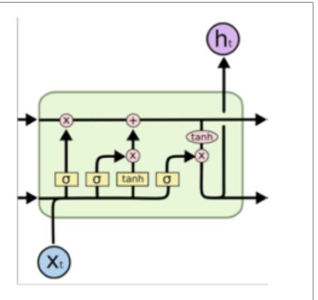
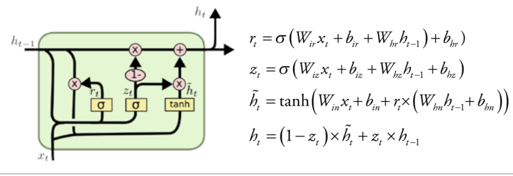

# 순환 신경망 (RNN)
- Recurrent neural network

## 순서와 시간에 따라 의미가 있는 데이터
- **시퀀스** 데이터(Sequence): 데이터가 순서가 존재하며, 순서에 따라 완전히 다른 의미를 가지는 데이터들
  - ex: 단어(TRIANGLE을 순서가 없으면 그저 알파벳 덩어리)
- **시계열** 데이터(Time Series): 시퀸스 데이터처럼 순서가 존재하지만 특별이 시간에 따른 의미가 존재하는 데이터
  - ex: 애니메이션 키프레임 위치(같은 값의 나열이라도 30fps냐 1fps냐에 따라 속도가 달라짐. 값 사이의 시간 간격 자체가 의미를 가짐)

## 작동 원리
### 구조도 이해
- 각 노드나 모듈이 순환이 되어서 순환 신경망이라고 불렀는데 순환 되는 것은, 이전의 결과값/계산값(`t0`) 지금의 입력값(`t1`) 을 같이 넣어서 이 모습이 마치 순환되는 것 처럼 보임
- **시간에 따른 역전파**: 인공 신경망에서 학습할때 각 노드들의 가중치를 구하기 위해서 역으로 계산하는 것을 역전파 라고 불렀던 것 처럼, 시간 순서로 펼친 RNN을 마지막 시점부터 거꾸로 따라가며, 공유하는 가중치 W의 기울기를 시점마다 구해 합산하는 역전파.

### 예제 6.3의 구조
- 우선 단순하게 모든 노드들은 쌍곡탄젠트($tanh$ 함수 사용)
- i2h : input to hidden, 입력값을 은닉층 업데이트, 통과
- h2h : 이전 은닉층 값에 i2h값을 통과시켜 새 은닉층 업데이트($input_t$ + $hidden_{t-1}$)
- i2o : 위의 과정을 통과한 새로운 은닉 상태를 출력으로 보냄(사실상 h2o, $hidden_t$ to $output$)

# 예제 6.3의 한계의 이유
- **기울기 소실(vanishing gradient)**: 예제에서 각 노드들을 쌍곡탄젠트/하이퍼볼릭 탄젠트(`Tanh`) 를 사용해서 미분하면 [0, 1]의 값이 나오는데, 기울기 값이 역전파 될때 타임 시퀀스가 길어질수록 시간 스텝마다 계속 곱해져서 제대로 학습을 하지 못하는 문제가 발생하는 현상을 **기울기 소실** 이라고 함
- 기울기 소실을 대응하기 위해서 `LSTM`, `GRU`를 사용

## LSTM

### 게이트
- 제일 상단의 셀 상태는 셀의 장기 기억을 담당하는 부분, 곱하기는 기존의 정보를 얼마나 남길지 따른 비중을 곱하고, 더하기로 기존 은닉 상태와 현재 들어온 데이터를 추가하는 부분
- 망각게이트(Forget Gate): 입력값에 제일 아래 왼쪽의 부분, 시그마는 시그모이드 함수(= 0에서 1 사이로 정규화 하는 함수)을 통해서 기존의 정보를 얼마나 전달할지 비중을 정해줌
- 입력게이트(Input Gate): 어떤 정보를 얼마큼 셀 상태에 저장할지 정하는 부분, 새로운 입력값과 직전 은닉 상태 값을 받아서 한번은 시그모이드 활성화 함수를 통과시키고 또 한번은 하이퍼 볼릭 탄젠트 활성화 함수를 통과 시킨다.

### 셀 상태의 업데이트
- 위의 망각과 입력게이트를 통해서 게이트를 통해서 셀 상태를 업데이트 한다.
- 은닉 상태의 업데이트는 시그모이드로 은닉 상태와 입력 값으로 비중을 정하고, 새로운 은닉상태는 업데이트된 셀 상태 값을 쌍곡탄젠트 함수에 통과 시켜서 [-1, 1] 사이의 비중을 곱한 값으로 생성한다.

## GRU

- LSTM보다 간단한 구조이지만 성능 면에서 밀리지 않는 RNN 변형 형태
- LSTM과 달리 셀 상태와 은닉 상태를 분리하지 않고 은닉 상태 하나로 합침
- 첫 수식 ${r}_i$는 *업데이트 게이트*로 새로운 입력값과 직전 시점의 은닉 상태 값에 가중치를 곱하고 시그모이드 함수를 통과시켜 업데이트 할 비중을 결정하는 부분
- 두번째 ${z}_i$ 수식은 *리셋 게이트*로 업데이트 게이트와 같은 입력을 받아서 동일하게 시그모이드 함수를 통해 비중을 정하고 그다음 수식($\tilde{h}_t$)을 구할때 기존 은닉 상태 값을 얼마나 반영할지 결정함
- ($\tilde{h}_t$) 는 기존 은닉 상태에 가중치가 곱해진 값과 새로운 입력 값을 입력받아 가중치를 곱한후 쌍곡탄젠트 함수를 통과해 새로운 정보의 값을 리턴함
- 마지막 ${h}_t$는 새로운 은닉 상태를 구하는 부분이고, 첫번째 수식에서 구한 가중치로 기존 은닉 상태와 $\tilde{h}_t$의 가중 합을 곱해서 새로운 은닉 상태의 값을 구함

# 임베딩
- 지금까지 원핫벡터로 글자 하나하나 원핫 벡터로 바꿔서 연산헀지만, 요소가 추가되면 그저 벡터의 길이(차원)만 늘어나고, 기존의 모델이 무의미해짐, 그래서 의미적 연산과 확정성을 위해서 사용 됨
- 원핫 벡터는 각각 단어들의 벡터를 내적하면 항상 0이 나오지만, 각 단어들 마다 아주 많은 숫자(50~300 차원이상)로 이루어진 벡터로 바꾸고, 각 숫자값은 학습을 통해 뜻이 비슷한 단어는 비슷한 벡터를 가진다.

## 간단한 설명

| 단어 | dim 1 | dim 2 | dim 3 | ... |
|---|---|---|---|---|
| python | 0.52 | 0.21 | 0.37 | ... |
| ruby | 0.48 | 0.21 | 0.33 | ... |
| word | 0.05 | 0.23 | 0.06 | ... |

- 단어 `python`과 `ruby`는 같은 프로그래밍 언어라서 유사한 벡터를 가진다.

### 예제와 같은 단어들을 벡터화(*word2vec*) 방법 들
- CBOW(continuous bag-of-words): 주변 단어들로부터 가운데 들어갈 단어가 나오도록 임베딩하는 방식. 즉, 같은 자리에 들어갈 수 있는 단어는 뜻이 비슷한 것을 이용해서 빈칸 채우기를 학습시키고 그 부산물로 의미가 임베딩
- skip-gram: CBOW와 반대로 단어 중심으로 부터 주변 단오들이 나오도록 학습하여 임베딩 벡터를 얻는 방법.

#### 예시

**the quick brown dog jumps over the lay fox** 에서 fox를 학습하는걸 가정
- CBOW: 'quick', 'brown', 'jumps' 'over' 라는 단어가 통과하면 fox가 나오도록 모델을 학습하고 그 은닉층의 벡터를 임베딩
- skip-gram: 'fox' 라는 단어가 들어올 때, 'quick', 'brown', 'jumps' 'over' 단어들이 나오도록 학습

